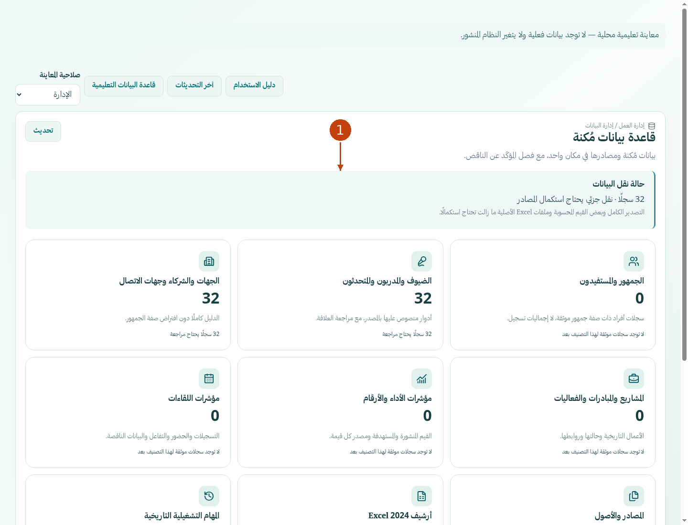
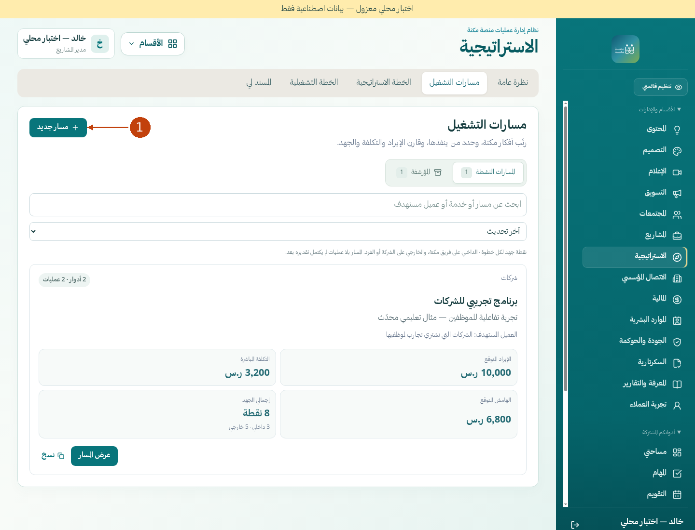

# ERP مُكنة | نظام إدارة العمليات

يجمع ERP مُكنة المشاريع والمهام والمعرفة والتقارير في واجهة عربية واحدة. تتيح مسارات التشغيل تنظيم الأدوار والعمليات، ويتيح مركز البيانات البحث والتصفية ومراجعة المصادر. يُعرض لكل مستخدم ما يلائم دوره.

## الأدوات

- **React وVite:** بناء واجهة عربية موحّدة.
- **Firebase Hosting وFirestore وFirebase Authentication:** استضافة التطبيق وإدارة البيانات وتسجيل الدخول.
- **Cloudflare Workers وWorkers AI:** خدمات مركز البيانات ودعم توليد الأفكار.
- **Vitest وESLint:** اختبارات آلية وفحوص لجودة الكود.

## جولة مصوّرة

الصور تستخدم بيانات تعليمية مصطنعة، وليست سجلات تشغيل فعلية.

- [صور مركز البيانات](screenshots/data-hub-20261116/)
- [صور مسارات التشغيل](screenshots/operating-routes-20261108-v2/)

هذا مستودع عرض؛ لا يتضمن الشفرة التشغيلية أو بيانات الإنتاج أو التقارير الداخلية.
